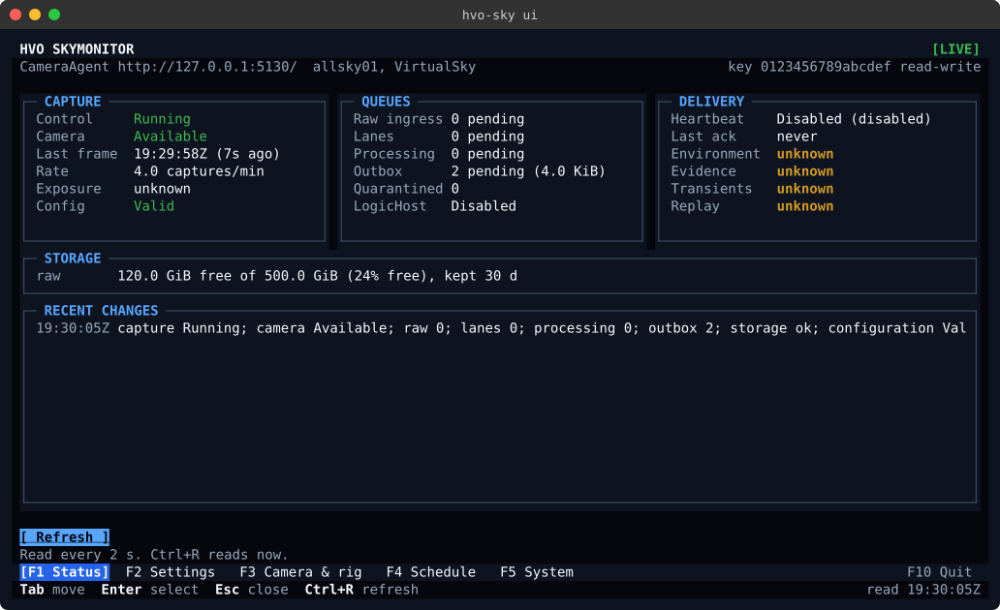
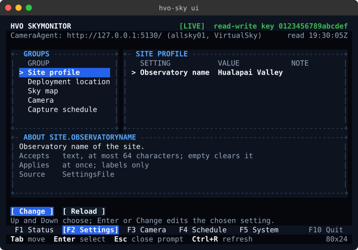
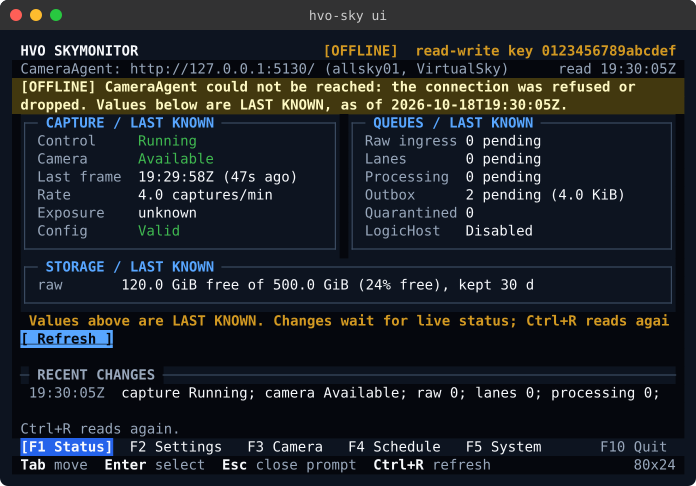
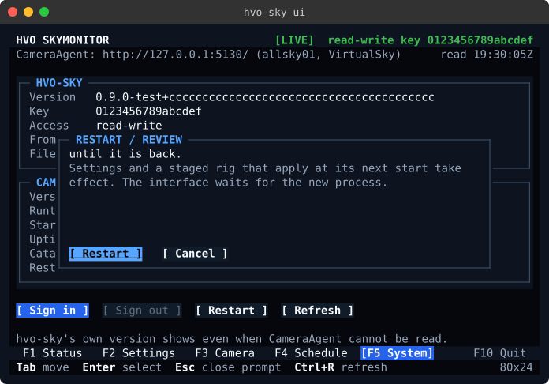

# hvo-sky: the CameraAgent command line

`hvo-sky` is the runtime client of a running CameraAgent (install contract section 8,
[#1317](https://github.com/HualapaiValley/HVO.SkyMonitor/issues/1317)). It shows the instance's status and versions,
reads and changes its operator settings, stages and applies rig and schedule changes, and restarts it, as commands or
in a full-screen terminal interface (`hvo-sky ui`). It talks to
CameraAgent's operations API over HTTP with an owner API key. It never reaches into CameraAgent's process, its
containers or its databases, and it needs no `sudo`.

The installer, `hvo-sky-install`, owns the lifecycle: install, upgrade, rollback and uninstall
([deployment-installer.md](deployment-installer.md)). `hvo-sky` owns the runtime. RoofController's `hvo-roof` is the
same kind of client, and `hvo-sky` follows it where the contract agrees.

## Install

`hvo-sky` is one self-contained file, so the machine needs no .NET runtime. Every release and integration pre-release
carries it for both platforms, as `hvo-sky-linux-arm64` and `hvo-sky-linux-x64` (asset kind `cli`), listed in
`SHA256SUMS` and attested like every other file ([prereleases.md](prereleases.md)). The installer does not install it
yet. Install it by hand on the CameraAgent host, or on any Linux machine that can reach the instance:

```bash
version=0.9.0-dev.4
cd "$(mktemp -d)"
gh release download "v$version" --repo HualapaiValley/HVO.SkyMonitor --pattern SHA256SUMS --pattern hvo-sky-linux-arm64
sha256sum --check --strict --ignore-missing SHA256SUMS
gh attestation verify hvo-sky-linux-arm64 --repo HualapaiValley/HVO.SkyMonitor --deny-self-hosted-runners
sudo install -m 0755 hvo-sky-linux-arm64 /usr/local/bin/hvo-sky
hvo-sky --version    # 0.9.0-dev.4+<commit>; the commit is release.json's
```

Use the same release as the instance, so the client reads the settings schema the instance serves. A client that
meets a settings schema it does not read says so and exits 1, rather than guessing.

## Signing in

The site owner creates API keys in CameraAgent's web UI, under **Account**, **API keys**
([cameraagent-operator-settings-v1.md](../contracts/cameraagent-operator-settings-v1.md#api-keys)). A key is shown
once. A `Read` key can run every command that only reads; a `ReadWrite` key can also change settings, stage and apply,
and restart.

```bash
hvo-sky login --url http://127.0.0.1:5130/    # asks for the key without echo
hvo-sky info                                  # the client's and CameraAgent's versions, and the key in use
hvo-sky logout                                # removes the saved key; the address is kept
```

- `login` reads the key from the terminal without echo, or as one line of standard input when there is no terminal.
  It checks the key with CameraAgent (`GET /api/v1/operations/info`) before saving it, and saves nothing when
  CameraAgent refuses it (exit 3).
- At a terminal, `login` without an address offers `http://127.0.0.1:5130/`, the installer's default listener. Without
  a terminal, give `--url` or set `HVO_SKY_URL`.
- `logout` only forgets the key on this machine. The key keeps working until the owner revokes it in CameraAgent. To
  replace a key, create the new one, run `login` with it, then revoke the old one.
- The installer binds CameraAgent to `127.0.0.1` by default, over plain HTTP, so `hvo-sky` runs on the CameraAgent host
  or reaches it through an SSH tunnel. Given a plain `http://` address on another machine, every command warns on
  standard error that the key crosses the network unencrypted, and `hvo-sky ui` shows the same warning in its notice
  band (`[PLAIN HTTP]`), when signing in and whenever nothing more urgent shows. This machine is its loopback and every
  address bound to one of its interfaces: on the CameraAgent host, its own LAN address, such as
  `http://192.0.2.10:5130/`, is not warned about when the request goes to it directly, because it never leaves the
  host. Through a proxy (`http_proxy` and the like) it does leave, so it is warned about unless `no_proxy` names it. A
  host name is not resolved, so a plain `http://` address given by name is always warned about.

## Credentials

- **The file** is `$XDG_CONFIG_HOME/hvo-sky/credentials.json`, or `~/.config/hvo-sky/credentials.json` when that
  variable is not set. `--credentials-file` names another. It holds the address and the key, written atomically with
  mode `0600` in a directory with mode `0700`.
- **Absent or unusable.** Only a file that does not exist (`ENOENT`, for the file or a folder on its path) is absent,
  which `hvo-sky` reports as not signed in. A file that exists but cannot be used is refused on every command, `logout`
  included, as unusable credentials (exit 3, `kind` `UnusableCredentials`), and `hvo-sky` says why:
  - it, or a folder on its path, cannot be reached or read (for example a folder with mode `0000`, or a file with
    mode `0200`);
  - it belongs to another user than the one running `hvo-sky`, or its folder belongs to another user than that user
    or `root`;
  - other users can read or change it, or change its folder, and it says which `chmod` fixes that;
  - it is not a credentials file this `hvo-sky` reads: another schema, an unknown member, or a key that is not in
    CameraAgent's format.

  `logout` on unusable credentials says that the key could not be removed, since it may still be in the file.
- **The environment** overrides the file: `HVO_SKY_URL` (the address) and `HVO_SKY_API_KEY` (the key). `--url`
  overrides both for the address. A variable whose value cannot be used is an error (exit 3) that names the variable
  and never repeats a key.
- **Never on the command line.** No option takes a key, a password or a token. An argument holding something shaped
  like a CameraAgent key, anywhere on the command line, is refused without being repeated or used (exit 2). An option
  such as `--api-key`, `--password` or `--token` is refused by name, without repeating its value. A key given that way
  may already be in shell history, so revoke it.
- **Never printed.** No output, error or `--json` document holds a key; they name a key only by its public identifier
  (the 16 hex characters after `hvo_sky_`). Requests carry the key only as `Authorization: Bearer`, never in a URL, and
  redirects are not followed, so the key is never sent anywhere but the address given.

## Commands

Every command takes `--json`, `--url`, `--credentials-file` and `--timeout`; `--help` describes each.

**`--timeout S`** (1 to 3600, default 30) is the one deadline of a command: the time it may spend waiting for
CameraAgent, across every request, every answer's body and every wait between reads, a restart's and a rig's included.
Time spent answering a prompt does not count. A command that runs out of time exits 1 and says it timed out
(`kind` `TimedOut`), which Ctrl+C (130) never does. A restart on a slow host may need longer than 30 s:
`hvo-sky restart --timeout 180`.

**`status --watch`** runs until Ctrl+C, or until CameraAgent refuses the key. One deadline would end every watch after
30 s, so there `--timeout` bounds each sample instead: its request and the reading of its answer. A sample that fails,
or runs out of time, is written as a line (`NOT READ: ...`) and the watch goes on to the next. Ctrl+C ends the watch at
once, even between samples: it exits 0 when its last sample was read and 1 when it was not, since a failed read says
nothing about CameraAgent's state. A key CameraAgent refuses (HTTP 401 or 403) ends it with exit 3.

| Command | Key | What it does |
| --- | --- | --- |
| `status [--watch [--interval S]]` | Read | The instance's status: capture control, the camera, the raw-ingress, lane, processing and outbox queues, storage, and LogicHost delivery. `--json` is CameraAgent's operations summary as it is. `--watch` reads it again every `--interval` seconds (default 2) and writes one line per change, and a line when CameraAgent stops or starts answering, until Ctrl+C; **`status --watch`**, above this table, gives its deadline and exit codes. A line ends `(stale)` when CameraAgent last observed that part more than 5 minutes ago, `(not observed yet)` when it has not observed it, and `(disabled)` when it is switched off. `Capture` is CameraAgent's live pause-or-run state and is never stale. |
| `info` | Read | `hvo-sky`'s own version, then CameraAgent's version, runtime, start time, catalog, whether it can restart itself, and the key in use and where it came from. |
| `config show [GROUP]` | Read | The settings by group, from CameraAgent's settings catalogue: each value, where it comes from, and whether it can be changed here. |
| `config get KEY` | Read | One setting: value, default, source, what it accepts, when a change applies, what it affects, and why it is read-only when it is. `KEY` is the full key, or the part after the group when that is unique. |
| `config set KEY=VALUE... [--reason R] [--dry-run] [--force]` | ReadWrite | Changes settings of one group. Each value is checked against the catalogue first (exit 2 and nothing sent when it is refused), and the group is sent with the version read, so a change made meanwhile is refused as a conflict rather than overwritten. An empty value clears a setting that may be empty. |
| `config diff FILE` | Read | How a settings file differs from the instance's settings. Nothing is sent. |
| `config apply FILE [--reason R] [--dry-run] [--force]` | ReadWrite | Changes every setting that differs from a settings file, one group at a time in catalogue order. |
| `restart [--force] [--no-wait]` | ReadWrite | Restarts CameraAgent, so settings and a staged rig that apply at its next start take effect, then waits (within `--timeout`) until a new process answers. |
| `rig show` | Read | The active and staged rig revisions, and the rig revisions the instance has. |
| `rig stage REVISION [--acknowledge-unvalidated]` | ReadWrite | Stages a rig revision for the next start, after CameraAgent's preview checks it against the active schedule. |
| `rig apply [--force] [--no-wait]` | ReadWrite | Restarts CameraAgent to apply the staged rig revision, then waits (within `--timeout`) until it is the active one, or CameraAgent reports that its camera failed to initialize. |
| `schedule show` | Read | The active and staged schedule revisions, whether capture is admitted now and when that changes, overrides, and the next capture windows. |
| `schedule stage FILE [--basis REV] [--reason R]` | ReadWrite | Stages a schedule revision from a capture profile: the `profile` of a revision as `schedule show --json` gives it, edited. `--basis` names the revision whose module and step options it keeps (default the active one). |
| `schedule apply [REVISION] [--reason R]` | ReadWrite | Activates the staged revision, or the one named, at the next capture boundary. An older revision goes back by rollback. Which one it is comes from the revision numbers CameraAgent lists; a revision it does not list is refused (exit 3). |
| `login`, `logout` | none | See [Signing in](#signing-in). |
| `ui` | Read; ReadWrite to change | The full-screen terminal interface: see [The terminal interface](#the-terminal-interface). |

### Settings

The settings are the ones CameraAgent's catalogue describes
([cameraagent-operator-settings-v1.md](../contracts/cameraagent-operator-settings-v1.md)): the site profile, the
deployment location, the sky map's object limit, the virtual sky's lighting and the active schedule revision. Paths,
listeners, central integration and credentials are not settings; the installer owns them.

- **One group at a time.** A group is the unit of one write. `config set` refuses settings of two groups (exit 2).
- **Read-only settings.** A setting that an environment variable, a secrets file or another source above the settings
  file supplies is read-only, and the reason names that source. `config set` and `config apply` refuse such a setting
  before anything is sent (exit 3).
- **When a change applies.** CameraAgent says, and `hvo-sky` repeats it: at once, at the next capture boundary, or at
  the next start (`PendingRestart`; `hvo-sky restart` applies it).
- **The location.** A change of the location and time basis that future captures are stamped with
  (safety `CaptureGeometry`) is confirmed at the terminal, or with `--force` when there is none.
- **A settings file** for `config diff` and `config apply` is strict JSON, keyed by full setting keys, with each value
  in its setting's JSON type, and `-` reads it from standard input. An unknown member, another schema version, a short
  or misspelt key, or a value of the wrong type is an error (exit 2), before anything is sent:

  ```json
  {"schemaVersion": 1, "settings": {"skyMap.maximumObjects": 500, "site.observatoryName": "Hualapai Valley"}}
  ```

  `config show --json` gives every value. This writes a file of the settings you may change:

  ```bash
  hvo-sky config show --json \
    | jq '{schemaVersion: 1, settings: ([.groups[].settings[] | select(.canWrite) | {(.key): .value}] | add)}' >settings.json
  ```

- **Partly applied.** `config apply` checks every value, and refuses any read-only one, before it sends the first group.
  When a later group then fails, the groups before it are saved, so the command exits 1 and says so. Running it again
  continues: the saved groups are no longer differences.

### Restart

CameraAgent restarts itself by stopping its own host, and relies on whatever supervises it to start it again: the
container's `restart: unless-stopped` policy, under the installer. It is the same restart as the Camera & rig page's
**Restart now**, and the two share one request per process. A CameraAgent that nothing would start again (outside a
container, unless `CameraAgent:Restart:Supervised` is `true`) refuses, and `hvo-sky` says so before it sends anything
(exit 3). The host stops gracefully, as `docker stop` stops it, so capture stops until it is back.

`restart` and `rig apply` ask first at a terminal; without one, and with `--json`, they need `--force` (exit 2 until
then). They then wait until a process with a new start time answers, through the old process stopping and the new one
starting. One that does not answer within `--timeout` exits 1, saying that CameraAgent accepted the restart but that
it could not be verified. With `--no-wait` they return once CameraAgent has accepted the restart.

### Rig and schedule

A rig revision is checked against the active schedule when it is staged, and against the camera only when CameraAgent
next starts with it: `rig stage` asks you to acknowledge that, or takes `--acknowledge-unvalidated`, as the Camera & rig
page's checkbox does. One rig revision, or one schedule draft, is staged at a time. `rig apply` restarts CameraAgent and
then reads the rig selection until the staged revision is active, which it becomes only once its camera has initialized.
A failure CameraAgent reports (the staged or the active camera did not initialize), a revision no longer staged, or the
end of `--timeout` is a failure (exit 1), with CameraAgent's reason when it gave one.

A schedule revision applies at the next capture boundary and needs no restart. CameraAgent takes going forward
(`activate`) and going back (`rollback`) as separate commands, and refuses either in the wrong direction. `schedule apply`
decides which from the revision numbers CameraAgent reports for the named revision and the active one. The schedule
lists the active, the staged and the most recent revisions; a revision it does not list, or one listed without a number,
is refused with the reason and nothing sent (exit 3), rather than guessed.

## The terminal interface

`hvo-sky ui` shows the same instance as the commands, on five pages, and makes the same changes with the same checks,
over the same API and key. It follows the terminal prototype of RoofController #158 (at RoofController `9cc8f2bb`,
`docs/prototypes/roofcontroller-terminal.html`), in HVO Dark, drawn with the installer wizard's
[`HVO.SkyMonitor.TerminalUi`](../../src/HVO.SkyMonitor.TerminalUi/README.md), whose colours and frames it takes as they
are: character-cell panels, aligned readings, and content bounded by its panel.



| Key | Page | What it shows, and what it changes |
| --- | --- | --- |
| F1 | Status | Capture and the camera, the queues, storage and, from 110 columns, LogicHost delivery; a line that sums the state up; the recent changes of state under a rule. Read every poll interval (2 s). |
| F2 | Settings | The settings catalogue's groups and settings, each with its value, source and whether it can be changed here, and the chosen one's rules. **Change** builds its form from the catalogue, as `config set` checks it, and sends the group with the version read: CameraAgent, not the form, says whether anything changed. |
| F3 | Camera & rig ("Camera" on the tab bar below 110 columns, so every page keeps its name at 80) | The active and staged rig revisions, the revisions, and the camera settings. **Stage** previews and stages a revision, with the acknowledgement `rig stage` asks for; **Apply** restarts CameraAgent and waits, as `rig apply` does. |
| F4 | Schedule | The active and staged schedule revisions, whether capture is admitted, the revisions and the next capture windows. **Apply staged** and **Activate** activate a revision at the next capture boundary, going forward or back from the revision numbers, as `schedule apply` does. |
| F5 | System | `hvo-sky`'s own version, the address and key in use and where they come from, and CameraAgent's version, runtime, catalog and restart support. **Sign in** checks a key with CameraAgent before saving it, as `login` does; **Sign out** removes it, as `logout` does; **Restart** restarts CameraAgent and waits for it. |

- **Header.** The first row has the badge and who the key is (`[LIVE]  read-write key 0123456789abcdef`), in the badge's
  tone; the second, CameraAgent's address and names, and when its status was last read. The key bar ends with the
  terminal's size.
- **Keys.** F1 to F5 choose a page and F10 quits; Tab moves between controls, Enter selects, Ctrl+R reads again. A change
  opens a review over the page (`RESTART / REVIEW`, `SETTING / REVIEW`) that says what it does; nothing is sent until
  its action is chosen. While a review or the sign-in form is open, F1 to F5 and F10 wait: Esc or Cancel closes it,
  and Esc never closes the interface.
- **No key of its own for Restart.** RoofController keeps F9 Stop on every page because stopping a roof is urgent and
  safe at any moment. A CameraAgent restart is neither: it stops capture until the new process is up, so it is a
  reviewed change like any other, two keys away (F5, then **Restart**), and a key that acted from any page would only
  make it easier to restart by mistake.
- **Changes need live status.** While what shows is stale, offline or last known, every change waits, and the page says
  why: a change made from values CameraAgent has not just said could act on a state that is gone.
- **Sizes.** Every page is usable at 80 x 24; from 110 columns the pages use the width, and 120 x 32 shows more rows.
- **What is current.** The header's badge says whether what shows is current: `[LIVE]`, `[STALE]` (not read again in
  time), `[OFFLINE]` (CameraAgent did not answer, or not within `--timeout`), `[SIGNED OUT]` or `[NOT SIGNED IN]`. A
  read that fails keeps the last values on screen, with `LAST KNOWN` in their panels' titles and when they were read:
  nothing is shown as current that CameraAgent has not just said.
- **Outcomes.** A change ends as the command would end it: done; refused (HTTP 4xx), and nothing changed; or
  `[UNVERIFIED]`: once CameraAgent has accepted it, with what it accepted and why it could not be verified, and when
  CameraAgent failed while handling it (HTTP 5xx) or its answer never came, that whether it was applied is not known.
  Only a refusal says a change was not made. The notice band takes up to three
  rows, so no outcome is cut at 80 x 24; the last action's outcome takes the band, and the badge and `LAST KNOWN` keep
  marking data that is not current meanwhile.
- **`--timeout`** bounds each read and change, since the interface runs until F10.
- **Terminals.** True colour where the terminal says so (`COLORTERM=truecolor`), otherwise its 16 ANSI colours;
  `NO_COLOR` gives the terminal's own colours with bold, reverse video and faint text; a locale that is not UTF-8 gets
  ASCII frames and nothing but ASCII; `HVO_TERMINAL` overrides either. Nothing is said by colour alone: states are
  words, the chosen row has `>`, the current page is in brackets, and a notice starts with its word (`[OFFLINE]`).
- **Exit codes.** 0 on F10; 130 on a signal; 2 without a terminal (standard input and output), or with `--json`; 1 when
  Terminal.Gui cannot start on the terminal there is. Scripts use the commands.







Every page's screenshot, at both sizes, in each fallback, while CameraAgent does not answer and with a review open, is in
[`docs/images/terminal`](../images/terminal) (`ui-*`). The interface's tests draw them on Terminal.Gui's in-memory
driver, and `scripts/docs:terminal-screenshots` refreshes the folder.

## Scripts

- **Output.** Results go to standard output. Errors, progress and prompts go to standard error.
- **`--json`.** Writes one JSON document on standard output. On failure, that document is
  `{"error": {"exitCode", "kind", "cause", "message", "status", "code", "detail", "errors", "settings"}}`, and nothing
  is written to standard error. `status --watch --json` writes one compact JSON document per line, for each change and
  each failed read, and its final error, when one ends it, is one such line too. A command line that cannot be parsed
  is reported as text on standard error with exit 2, even with `--json`.
- **Unattended use.** A script never gets a prompt it cannot answer. Without a terminal, a key is read as one line of
  standard input, and a question no one can answer is exit 2 with the option that answers it (`--force`,
  `--acknowledge-unvalidated`).
- **Retries.** A change carries a fresh `Idempotency-Key` and the version it read. A refused change (exit 3) changed
  nothing; read again and retry. After exit 1, check with `hvo-sky status` or `config show` before retrying.
- **A change accepted, then a failure.** Exit 3 means the command changed nothing. Once CameraAgent has accepted a
  change (a restart, a staged rig or schedule, an activation, a settings group), any later failure exits 1 with `kind`
  `Unverified`, saying what was accepted and why it could not be verified; `cause` is the failure's own kind, such as
  `SignedOut` for a key refused while waiting. Ctrl+C then still exits 130, saying the same. When a change's own
  request fails without an answer, the message says that whether CameraAgent received it is not known. When CameraAgent
  answers a change with a server error (HTTP 5xx), it may have made the change before failing: exit 1 with `kind`
  `Unverified` and `cause` `Failed`, saying that whether it was applied is not known. Only a refusal (HTTP 4xx) says a
  change was not made.

### Exit codes

They are the installer's ([deployment-installer.md](deployment-installer.md#exit-codes)) wherever the meanings overlap.
With `--json`, the error document's `kind` says which case it was.

| Code | Meaning | `kind` |
| ---: | --- | --- |
| 0 | Done, or nothing to change. | |
| 1 | A step failed; re-running continues. CameraAgent could not be reached, answered with a server error (HTTP 5xx) or an answer that could not be read, or a staged rig did not become active; the command ran out of time (`--timeout`); CameraAgent accepted a change that could then not be verified; `config apply` stopped after an earlier group was saved; `status --watch` was ended while CameraAgent was not answering. | `Unreachable`, `Failed`, `TimedOut`, `Unverified` |
| 2 | The command line was not valid (an unknown command or option, a missing or malformed value, a value the settings catalogue refuses, or a credential given on the command line), or a question had no one to answer it. Nothing was sent. | `Usage`, `ConfirmationRequired` |
| 3 | Refused, and nothing changed: no address or key, a credentials file or credential variable that cannot be used, CameraAgent did not accept the key (HTTP 401) or its access (HTTP 403), refused the request (a version conflict, a read-only setting, a value it does not accept, a state that does not allow it, a CameraAgent that cannot restart itself), a schedule revision whose order cannot be established, or a person answered no. | `NotConfigured`, `UnusableCredentials`, `SignedOut`, `Forbidden`, `Refused` |
| 130 | Interrupted (Ctrl+C, SIGTERM, or the terminal closing). What was already sent may still take effect; after CameraAgent accepted a change, the message says so. | `Interrupted` |

`logout` sends nothing, so it exits only 0, 2 or 3. `status --watch` ends on a signal by design: it exits 0 when its last
read succeeded and 1 when it did not.

### Signals

SIGINT (Ctrl+C), SIGTERM and SIGHUP (the terminal closing, or an SSH session dropping) are handled alike. The first ends
the command, which reports what it had done and exits 130 (`status --watch` exits as above). The process still ends 5 s
after the first signal, and a second signal ends it at once.

## The API it uses

Everything is under `/api/v1/operations`, where CameraAgent accepts an owner API key. Besides the settings routes of
[cameraagent-operator-settings-v1.md](../contracts/cameraagent-operator-settings-v1.md):

| Route | Policy | Used by |
| --- | --- | --- |
| `GET summary` | read | `status` |
| `GET info` | read | `info`, `login`, and `restart` and `rig apply` (the process start time they wait to change) |
| `POST restart` | mutate; a browser session also needs an antiforgery token | `restart`, `rig apply` |
| `GET rig-profiles`, `GET rig-profiles/preview/{revision}`, `POST rig-profiles/stage` | read; mutate to stage | `rig` |
| `GET schedule`, `POST schedule/stage`, `POST schedule/activate`, `POST schedule/rollback` | read; mutate to change | `schedule` |

`GET info` returns `schemaVersion` (1), `application` (`name`, `version`, `revision`, and `informationalVersion`, the
`<version>+<commit>` build identity), `host` (`runtime`, `runtimeIdentifier`, `processStartedUtc`, `uptimeSeconds`),
`catalog`, `restart` (`supervised`, `requested`) and `caller` (`credential`, `Session` or `ApiKey`, with the key's
public `apiKeyId` and its `access`). `POST restart` answers `202` with `status` `Scheduled` (or `AlreadyRequested`
when another caller asked first in this process) and `delaySeconds`, and the host stops that long after answering. It
answers `409` with code `restart.unsupervised` when nothing would start CameraAgent again. A restart through the API is
logged at Information, with the owner; a key-authenticated change is also logged with the key's identifier (event 4194).

## Tests

Nothing here needs a camera, Docker or a Pi.

- **Commands** run in the test process against a fake operations API (`tests/HVO.SkyMonitor.CameraAgent.Tests/Cli`):
  every command's output, `--json` and exit codes 0, 1, 2, 3 and 130, the credentials file's modes, the environment
  overrides, the refusal of credentials on the command line, and that no output or URL ever holds the key.
- **The new routes** are tested with the host's authorization metadata (`CameraAgentSystemOperationsEndpointsTests`).
- **The terminal interface** runs on Terminal.Gui's in-memory driver against the same fake API
  (`tests/HVO.SkyMonitor.CameraAgent.Tests/Cli/Ui`): the command's exit codes, the pages and keys, what is marked when it
  is not current, each change and its outcome, and every page's screenshot at both sizes and in the fallbacks.
- **Against the real host,** `HvoSkyCliTests` (Integration) runs `login`, `info`, `status`, `config`, `restart`, `rig`,
  `schedule` and `logout` against the in-process CameraAgent with keys the owner created, including a Read key refused a
  change and a revoked key.
