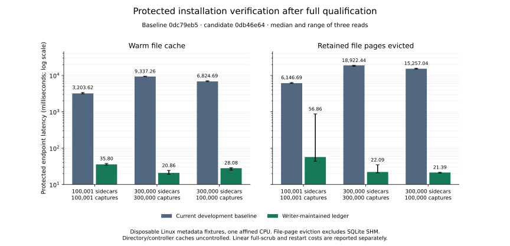

# #1041 correction: writer-maintained retained integrity

> The owner completeness verdict at `da8fbbf7` was withdrawn after Opus found
> blocking concurrency, first-upgrade recovery and recurring-load costs, and Sol
> reported a deleted-ledger restore bypass before its provider disconnected.
> The [next correction report](issue-1041-run3-high-corrections.md) records the
> new behavior, validation and remaining review requirements. Measurements below
> remain observations of the named run-2 product, not passes for later code.

Refs #1041. This report supersedes the withdrawn completeness verdict at
`c4069b8c`. Roy approved Option A on Nov 10, 2026 at 14:04 PST / 22:04 UTC
(widget t356s2122, relayed by Kepler): out-of-band tampering moves from the next
protected read to the next full scrub. No other guarantee is relaxed.

Status: implementation/local evidence complete for the approved software scope.
Required HIGH re-reviews belong to Kepler; this report is not a Sol/Opus approval
or permission to create a PR.

## Sources and scope

The owner read the original issue and all 13 original comments before initial
implementation, and the subsequent correction/approval discussion during run 2.
The original requirements are retained in #1041, including the shipped #1042
finite shared 120-second deadline, transport/authentication protections and
pre-mutation comparisons. The reports for #1559, #1591 and #1618 remain the
attribution sources; their old 35,049 ms/small-fixture results are not current
measurements. The prior full-byte cache did not solve the linear-I/O problem.
The design was pushed before product edits in `1b1bbf1f`, linked from
[issuecomment-6779992529](https://github.com/HualapaiValley/HVO.SkyMonitor/issues/1041#issuecomment-6779992529).
The issue body and all 36 comments were refreshed on Nov 11 at 06:22 UTC, including
the original 13 comments, the withdrawn run-1 verdict and run-2 approval. Roy's
Nov 10 implementation authorization and later Option A approval supersede the
older attribution-only queue scope. The incident figures are the supplied signed
report, not new measurements from a live agent.

Work is isolated on home-dev-03, branch
`kepler/1041-bounded-installation-verification`, originally branched from fetched
`development/v1` `d122742c7b619a887168d3f9e2b4f23e54ba6ee7`.
No production/beta request, token, deployment, live data/container, CLIProxy,
network configuration, PR, review request or merge operation is part of this work.

## What is verified, and when

Each qualified protected request freshly reads/parses/validates configuration
and its 366-day schedule, protected location history/marker/manual state,
installation fields, owner readiness and a small authenticated integrity
checkpoint. It does not enumerate, read, hash or parse retained history, or open
the retained ledger database. A one-second limit applies to each local gate wait.
Unqualified/missing/expired/busy state returns sanitized HTTP 503 with
`Retry-After: 1`; there is no successful identity response or installer bypass.
New clients retry only HTTP 503 carrying the explicit `scrub-pending` header.
The same original finite 120-second CTS covers every attempt, retry delay and
final response body; it is never restarted. Other unsuccessful responses fail
immediately. Exhaustion/caller cancellation retain the #1042 distinction and
sanitized diagnostics; all field comparisons still precede mutation.

The checkpoint is bound to a new process epoch, validator/Common/AgentCore/runtime
identity and current protected-history identity. It includes an authenticated
mutation generation, entry count and set commitment. A new process never inherits
readiness from disk. Endpoint work is independent of retained capture/product
count; current configuration/history size still determines its own validation cost.

A full scrub authenticates the expected-entry set and reads/hash-validates every
current raw-root JSON file and raw journal manifest, including schema and location
provenance. Unexpected additions, deletions and byte changes are drift, even if
the replacement is valid JSON with valid provenance. Per-entry authenticated
proofs plus a protected SHA-512 additive set commitment detect row changes,
deletion and replay. Pending mutation intents have their own authenticated set commitment. A fresh
readonly pathname check prevents an old open SQLite inode from hiding a replaced
durable database during qualification/publication. This addresses a new ledger
path-replacement interaction, in addition to the configuration snapshot race
called out below. The nonce, count, generation and commitments are themselves
protected; the database alone cannot certify a generation.

Full scrubs run during normal startup/configuration load, after unqualified reads
request coalesced revalidation, and every 24 hours. The fast path independently
expires qualification after 24 hours; managed writes cannot extend it. A dirty
read starts at most one host-owned refresh, with a 30-second failed-attempt
cooldown. Caller cancellation does not cancel/restart that refresh; host shutdown
cancels it. No incomplete scrub qualifies a checkpoint. Full scrubs are linear
work and can temporarily refuse protected reads. Per-entry barriers allow managed
writers between observations; finalization revalidates changed/missing keys and
publishes authority/checkpoint under the barrier. Initial commitment checks and
final database replacement/commitment computation also hold the barrier.

**Accepted integrity tradeoff:** unmanaged/out-of-band edits after qualification
may precede a successful protected read until a full scrub detects them. Watchers,
mtime and length are not treated as byte-integrity proofs. Schema/provenance is
checked at managed publication and full scrub; current configuration/protected
identity remain fresh on every protected read. Payload-byte verification was not
part of the original protected metadata scan and is not newly claimed here.

The configuration loader now returns the canonical hash of its exact parsed JSON
snapshot and checks the file again before location-authority publication. This
explicitly touches the previously excluded configuration-file reopen race: an
asynchronous scrub must not freeze stale input as immutable installer identity.
It does not claim a transaction with arbitrary external editors after that check.

## Durable writes and recovery

`retained-integrity.v1.db` is required integrity state, unlike the disposable
`retained-validation.v2.db` parse index. Managed writes persist an authenticated
key/prefix and declared digest (or source mapping/deletion) before changing data.
They validate affected current bytes afterwards, update expected entries and
metadata in a FULL-synchronous SQLite transaction, then atomically/fsync publish
the protected checkpoint. Fast reads wait or refuse while that barrier is held.
Failed/unknown results leave integrity unqualified. A registration barrier drains managed writes that began before an integrity
owner existed, so initial qualification cannot miss their eventual publication.
Nested publication scopes preserve that barrier across async calls. A managed
writer cannot
launder unexplained pre-existing drift by replacing/deleting it. Quarantine can
preserve damaged bytes, but never qualifies those bytes as valid evidence.

A crash before/after data publication leaves authenticated pending intent;
restart performs full current-byte/schema/provenance verification and can accept
only unchanged evidence or the declared valid outcome. Torn results refuse
verification. Offline restore/rollback starts a fresh epoch and requires a full
scrub, including paired ledger/evidence comparison. Incomplete restores and old
writers that changed evidence without this ledger are refused as drift. Restoring
a complete paired backup can requalify; no cached checkpoint is sufficient.
A damaged/unreadable authoritative ledger cannot grant trust and is not silently
reset. Preserve it and the retained evidence for recovery; restore a known-good
paired state or repair against expected bytes through an explicitly authorized
recovery procedure. Do not delete evidence or the ledger to force adoption.

Startup tolerates torn/schema-invalid sidecars in quarantine and frames so the
real reconciler and authenticated recovery UI remain available. A startup scrub
that detects drift retains the original expected set and keeps protected reads
unqualified. Valid contradictory location provenance/protected authority retain
their existing startup refusal. Invalid quarantine evidence is preserved and can
still refuse lifecycle verification; moving it does not erase the finding.

The advisory parse index has no whole-corpus capacity cap. Small transactions
persist only fully validated exact-content/type/history/build proofs, even when
a full read is canceled or fails. Auxiliary JSON is classified once and cannot
satisfy a required frame contract. Index I/O/ENOSPC is best-effort and cannot
roll back durable location authority or leave in-memory location at an old
version. Cleanup is bounded; optional damage is a cache miss/rebuild.

## Recovery audit: adoption and paired rollback

The final audit after `18ef8881` found an additional blocking case: removing both
ledger database and checkpoint could masquerade as a first legacy adoption.
Protected history now seals the original ledger nonce. Fresh nonce metadata is
persisted and synced before that seal is published; a crash during adoption
resumes full verification with the same nonce. Missing or mismatched required
state stays unqualified, including when both ledger files disappeared. Genuine
legacy history is still fully verified, then sealed without changing location
identity/version or current configuration identity.

This evolves the private history reader contract. The image reader floor advances to
`b3e8a77737672ae48b7c178c53dbad9790687d2a`, the first sealed-history implementation commit. Migrating lifecycle
snapshots now pair the SQLite stores (including the optional integrity database)
with four confined location/marker/checkpoint files, recording presence or
absence and hashes. All snapshot contents are verified before restore; file
publication is atomic, synced and resumable. Retained captures/products are
preserved. Rollback to an older reader restores its exact pre-upgrade history.

Historical database-only snapshots remain usable for legacy state. They cannot
reconstruct a sealed location/ledger pair and are refused before mutation when
new integrity state is present; use a complete paired backup. Older installers
remain compatible with the protected HTTP success contract, but paired-state
rollback requires the updated installer. This compatibility change is explicit;
no identity, authentication or integrity check is bypassed.

Focused adoption evidence: **70/70** CLI cases and **121/121** adoption/staging cases.
The first adoption run had one incorrect crash-hook setup (120 passed/1 failed):
the hook fired before history existed; it now interrupts after history
publication. The actual pre-seal-image upgrade/rollback campaign passes on the immutable
candidate. The scale tables below are renewed on `0db46e64`; `18ef8881` measurements remain historical evidence.

### Preserving post-snapshot files during database rollback

The first actual pre-seal-image campaign exposed a further interaction: the
candidate published 24 valid new JSON files, but rollback restored a ledger that
predated them. The older runtime correctly refused its now-stale expected set;
the client exhausted its existing budget and recovered the original runtime.
This failed campaign is retained as failure evidence, not credited as a pass.

Database restore now preserves authenticated CURRENT file expectations and
restores authenticated SNAPSHOT journal expectations. Both complete source
commitments, row proofs, schema and nonce are authenticated before composition;
unsettled or different-authority sources refuse. No file bytes are blessed as
new proofs. The wire definitions are shared by the agent and the installer's
offline writer. The writer holds the root's exclusive integrity-owner lock and
rechecks source commitments while staging. A protected, snapshot-bound derived
overlay makes retries idempotent; an incomplete overlay can rebuild only from
authenticated source authority. The restarted agent still performs full byte,
schema and provenance verification before qualification.

A pre-ledger database snapshot cannot preserve current file proofs and is
refused before mutation when current ledger state exists. Use a complete paired
backup for that older downgrade. This is a disclosed development-version
compatibility limitation. The dedicated campaign targets pre-SEAL `18ef8881`,
which already understands the v1 ledger; it also checks exact old history bytes
and complete installation identity after rollback. The generic owner-recovery
baseline campaign assumes an older, pre-recovery image and was not a valid
fixture for `18ef8881`; its early fixture refusal is not a product failure.

Focused correction evidence: **128/128** protected-store/staging cases and
**70/70** CLI cases pass warning-clean. Real-store cases exercise current file
preservation, tampered proofs, cancellation before and after ledger installation,
incomplete-overlay recovery, new-file cache invalidation and live-owner refusal.
Both immutable-candidate actual-image campaigns pass: the dedicated pre-seal upgrade/rollback and the complete current-image installer campaign. Canonical gate totals are recorded below.

## Managed-writer inventory

| Path | Ledger integration | Scope |
| --- | --- | --- |
| Raw ingress publication and capture journal commit/recover | Declared sidecar bytes before atomic publication; declared capture key/manifest before journal transaction | New raw evidence; schema migration dirties/requires full scrub |
| FileSystemFrameStorageService, CaptureProcessingPersistence, CameraAgentFileSystem | Prepared publication guards; tracked moves/deletes | Raw/preview/derived artifacts and sidecars |
| RawIngressReconciler, DerivedProductReconciler, CalibrationLibraryReconciler | Guarded moves/copies/deletes and tree quarantine | Evidence preserved; invalid evidence never qualifies |
| RetentionBackgroundService, ProjectedSceneRetentionGuard, time-lapse recovery | Guarded per-file or affected-prefix deletions/moves | Expected tombstones prevent missing evidence being silently adopted |
| CalibrationArtifactPublisher, ManualFocusSessionStore | Guarded atomic JSON publication | Manifest/auxiliary JSON inside the registered raw root |
| CaptureSatelliteWorkStore, ProjectedSceneStagingStore, NightlyProductStore | Prepared/guarded publication and cleanup, including Linux native renameat2/linkat/unlinkat staging paths | Auxiliary JSON classified under existing owner contracts; native staging/restart regression |
| SiteProfileStore, OperatorSettingsFile, CameraAgentControlStore | Guarded writes/atomic publication | Fresh owner settings; no cached installer identity |
| OrbitalElementsStore, ManagedTimeDataStore, environmental outbox | Guarded direct atomic publication/deletion | No-op for integrity outside the raw root or non-JSON data |
| Installer backup/restore/rollback | Existing offline lifecycle operations; process epoch invalidates all restored readiness | Paired full verification after restart; no live restore bypass |

Shared host-neutral filesystem ownership remains in Storage.FileSystem; CameraAgent
owns the ledger/writer policy. Binary payloads, JSONL, temporary files and unrelated
SQLite row-state updates were outside the original metadata scan. Prepared JSON
publication is guarded at its final tracked destination. Device-secret/identity
writers remain under their existing separate identity roots. Linux only.
Auxiliary JSON retains its existing model owner: the retained scrub requires
valid JSON syntax and exact expected bytes, and applies the frame contract only
to artifact/frame evidence. It does not replace auxiliary-model validation with
a frame contract or newly claim to validate every auxiliary schema.

## Production multiplicity

The installer-generated configuration is produced locally by the BCL-only
[configuration generator](issue-1041-run2-configuration-generator.cs.txt); the
fixture rewrites only its two storage roots and seeds a completed synthetic
owner. The default graph declares four ScenePresentation outputs, two
EnvironmentPresentation outputs, one ProjectedScene and one OverlayManifest:
eight structured metadata products when those stages complete. Each has a JSON
payload **and** a `.manifest.json` sidecar (`CaptureProcessingPersistence`). Raw,
RollingCombination, CombinedPreview and PresentationMaterializer add image/binary
artifacts and their sidecars; optional cloud products add further evidence.
Thus the complete successful graph can produce about twelve sidecars and twenty
retained JSON files per capture before optional products. These are file counts,
not twelve entries in the old artifact-proof set: at `c4069b8c` only successfully
parsed `ArtifactManifestV2` values entered that set. The eight layoutless metadata
products use their separate durable-product manifests and were not cached there.
If all four distinct image/v2 products are retained, the 262,144-proof cap is
reached at about **65,536 captures**; the three-image fixture reaches it near
87,381 captures. Duplicated digests, optional outputs and retention change that
ratio. Counting all twelve sidecars would incorrectly imply 21,845 captures.
These are source-based conditional counts, not a production capture measurement.
The new index caches typed artifact and auxiliary proofs without that cap.

The scale cohorts count manifests, raw-journal rows and captures separately.
The three-product cohort is a conservative synthetic Raw/Preview/AnnotatedPreview
fan-out (100,000 captures, 300,000 sidecars, 100,000 journal rows), not a claim to
reproduce all default graph outputs. Auxiliary JSON correctness is covered by
seven owner-model/layout cases, including a structured metadata payload beside
its manifest. The endpoint takes the same fixed path regardless of either kind.

## Disposition of the c4069b8c findings

| Finding | Correction | Direct evidence |
| --- | --- | --- |
| HIGH-1: linear endpoint and canceled-read loop | Writer-maintained authenticated checkpoint replaces per-request traversal/hashing. Host-owned qualification survives canceled callers. Completed parse proofs persist in small transactions, with no corpus-size cap. | Real authenticated endpoint at all three scale cohorts; zero retained-scan spans and zero artifact parses on qualified reads; durable restart reuses all old proofs, including beyond 262,144. `DirtyEndpointRefusesPromptlyAndCoalescedScrubSurvivesCallerCancellation` and `MidScanCancellationPersistsOnlyCompletedProofsAndStillReadsCurrentBytes`. |
| HIGH-2: invalid quarantine/frames evidence blocks startup | Normal startup preserves evidence and recovery access; strict qualification still refuses invalid retained evidence. | Three exact bad-sidecar layouts, real recovery UI, actual reconciler interaction and production `frames/.../Raw` layout. |
| MEDIUM-1: optional cache write blocks unchanged load | Optional-index write/cleanup failures log safely and continue; required ledger failures remain unqualified. | Injected disk-full on unchanged load and real location change, plus actual host startup with optional-index failure. |
| Low: disk/memory location disagreement after optional failure | Durable authority is published to memory before advisory proof persistence. | `OptionalIndexWriteFailureKeepsDurableAndInMemoryLocationConsistent` covers both unchanged and changed location. |
| Low: orphaned advisory temporary files | Bounded, confined, best-effort cleanup; retained evidence is never cleanup input. | `OrphanCleanupIsBoundedAndNeverDeletesEvidence`. |
| Low: layout and auxiliary JSON gaps | Segment-based frames detection and typed exact-content proofs; auxiliary JSON is classified once and never supplies a required frame contract. | Seven owner-model/layout cases and real structured payload plus sidecar; startup/reconciler tests. Linux remains the only product platform. |
| Low: operator documentation understates behavior | This report supersedes the old completeness verdict; changelog/runbook state the scrub tradeoff, startup tolerance, optional versus required state and fail-safe recovery. | Operations-doc audit and this source/requirement crosswalk. |

The supplied combined findings are the review source. The Sol report on hvo-dev-04
was unavailable on this host and is not claimed as personally inspected. These
corrections are owner evidence; they are not independent CLEAN verdicts.

## Requirement → behavior → evidence

| Requirement/source | Behavior | Local test/evidence | Result |
| --- | --- | --- | --- |
| R1: current costs and 100k+ bounded endpoint | Fixed checkpoint plus fresh current identity, no retained scan; exact product/capture counts | Real endpoint scale, warm and fixture-only evicted at 100,001/300,000 sidecars | PASS; all three cohorts, zero retained scans/parses |
| R2: tamper/schema/corruption and retained provenance | Approved scrub boundary; managed validation; authenticated expected set; strict qualification | OutOfBandBoundary, LedgerTamper, WarmIndexRejectsInvalid, startup/quarantine tests | PASS at tested candidate |
| R3: authoritative identity/readiness and concurrent edits | Exact config snapshot/freshness callback; history/manual/owner state fresh; no fast-path authority changes | QualifiedProtectedRead, StaleBackgroundConfiguration, actual delayed/config/manual/authenticated endpoint edits | PASS at tested candidate |
| R4: installer budget/auth/comparisons/pre-mutation | Existing #1042 shared 120s finite policy and transport protections; only explicit pending-scrub responses retry within that budget | Existing owner client/resume tests; upgrade/rollback/backup mismatch/timeout/cancel/plan cases; full disposable installer campaign | PASS; full CLI selection rerun with the corrected candidate-only fixture expectations |
| R5: cancellation/failure/progress | Independent coalesced scrub; canceled full scan saves individually valid proofs only | DirtyEndpoint, MidScanCancellation, optional-index fault tests | PASS at tested candidate |
| R6: invalidation/concurrency/writers | Exact expected-entry updates, dirty refusal, changed-generation merge and finite waits | ManagedPublishCopyMoveRetention, NativeStagePublicationCompletionDeletionAndReconciliationRemainQualifiedAcrossRestart, concurrent scrub/writer, daily deadline, raw journal integration | PASS at tested candidate |
| R7: crash/restore/rollback | New epoch always unqualified; pending declared results verified; no reset | Actual SIGKILL before/after/torn write; paired restore/rollback and incomplete-restore tests; full disposable campaign | PASS at tested candidate |
| R8: compatibility/adoption | Wire fields/auth unchanged; currently running agent always answers | Matrix below; existing endpoint/CLI contracts | PASS; current-source contracts and matrix |
| R9: HIGH/Tier C validation | Classifier-selected affected gates, canonical coverage and four CI guards | Exact range/classifier and command/TRX ledger below | PASS |

## Compatibility

| Installer | Running agent | Behavior |
| --- | --- | --- |
| Old | New | Same success wire contract and comparisons; qualified reads benefit; 503 requires later retry after scrub; paired-state rollback requires the updated installer |
| New | Old | Same finite client deadline/comparisons; old full-scan endpoint can still exceed 120 seconds |
| New | New | Bounded qualified reads; explicit pending responses share the original 120s budget; no identity or mutation until requalified; database rollback requires a compatible ledger, with complete paired backup for pre-ledger targets |

Pre-mutation verification always executes on the currently running agent. A
server-only fix cannot unblock pre-upgrade verification of an already-slow old
runtime. The fresh empty instance is an adoption window, not a correctness
assumption. There is no timeout increase, unbounded retry, identity bypass or reset.
`--plan` still returns before the protected pre-mutation read and remains dry-run.
An agent that predates the ledger cannot maintain it when writing after rollback:
a subsequent new agent detects that drift and refuses qualification.
Development policy permits such upgrade incompatibility; it is disclosed rather
than silently trusting old-writer changes.

## Measurements and candidate gates

Cache-evicted means file-scoped `fsync` + `POSIX_FADV_DONTNEED`, followed by
`mincore == 0` for each retained data/main-journal/checkpoint file. Construction
closes fixture SQLite pools and checkpoints/truncates the idle raw journal WAL;
transient SQLite SHM coordination pages are excluded. Residual data pages get
at most five short file-scoped retries, then fail the experiment. No global
`drop_caches`, live service, image payload or production storage is involved.
Directory/controller caches and full-machine cold start are not controlled.
Three preliminary baseline attempts failed this precondition: one repeated an
older harness after a concurrent formatter writeback; the diagnostic attempt
identified 240 pinned `.db-shm` coordination pages. These attempts contribute no
baseline performance result. The corrected fixture boundary is applied to both
baseline and candidate. Full qualification, durable-ledger restart qualification and five prepared/durable
auxiliary publications are recorded separately from endpoint timing. Restart
must requalify in a fresh store epoch and reuse all existing artifact proofs;
only the newly published auxiliary state is parsed. The extra restart phase
is candidate-only and follows every timed endpoint/publication sample.

The measured product candidate is
`0db46e64a1ef30aef4bc38655f0a4459e3999efc`. The final handoff commit adds
documentation/evidence and three test-expectation corrections: the candidate-side
reader-floor value, explicit snapshot inventory/restore boundaries, and the
manual-history sealed field contract. Both
actual consumers rebuild warning-clean in Debug/Release and rerun their full
canonical selections with frozen test-source fingerprints. Frozen previous-release
image labels, SQL images and prior values are unchanged. Product, scripts, workflow
and pinned toolchain trees remain byte-identical to that immutable candidate;
final test blobs are matched to the executed fingerprints. Each reused selection
retains its actual tested SHA and a byte-identical transitive source-closure
proof; no previous failed run is credited as a pass. Historical run-1/reviewer
numbers are not represented as current results.

The baseline is freshly fetched `development/v1`
`0dc79eb582e2e2a583da98af0d50f61992fd2839`. All **2,015 tracked product-source
files** in its isolated source archive match that Git tree byte-for-byte. The
test-only endpoint harness is the same for both cohorts, except candidate-only
qualification/index assertions and the restart phase after timing. Baseline
build informational metadata can inherit the containing worktree's Git identity;
the source proof, rather than that metadata, establishes the baseline revision.

Both use Release, SDK 10.0.402 / runtime .NET 10.0.14, one affined CPU, a 1 GiB
managed-heap limit and completed synthetic owner settings. Timings are actual
authenticated Kestrel GETs through the real configuration loader/store and a
real v15 raw journal. Acquisition is disabled. The fixture uses contract-generated
metadata and no image payloads. Three settling reads precede three measured warm
and three independently evicted reads. Attribution listeners are active in both.
Every evicted sample proves zero resident retained-data pages before its GET.

Median endpoint latency, milliseconds:

| Sidecars | Captures / journal rows | Products per capture | Baseline warm → ledger warm | Baseline evicted → ledger evicted |
| ---: | ---: | ---: | ---: | ---: |
| 100,001 | 100,001 | 1 | 3,203.62 → **35.80** | 6,146.69 → **56.86** |
| 300,000 | 300,000 | 1 | 9,337.26 → **20.86** | 18,922.44 → **22.09** |
| 300,000 | 100,000 | 3 | 6,824.69 → **28.08** | 15,257.04 → **21.39** |

All qualified candidate samples perform **zero retained-scan spans and zero
artifact parses**. The largest warm sample is 37.75 ms; the largest evicted
sample is 872.81 ms. The implementation's fixed checkpoint path and the
no-traversal/concurrent-read test establish the bounded work; three samples do
not establish a universal latency distribution. Timing variation between cohorts
is not evidence that larger histories make the endpoint faster.

The ordered manifest-stream hashes match across baseline/candidate. Manifest
bytes (file plus journal metadata) are 488,782,680 / 1,466,777,790 / 988,555,580.
All compared identity fields agree across implementations except the expected
configuration hash of their two distinct disposable storage roots. Each fixture
checks its complete identity remains unchanged through repeated/evicted reads,
managed publication and restart, and retained input checksums remain unchanged
through timed reads. Current configuration is not cached as identity.

Median allocation and logical I/O per warm GET:

| Sidecars / captures | Baseline allocation → ledger (MiB) | Baseline logical reads → ledger (bytes) | Baseline → ledger maximum sampled process peak (MiB) |
| ---: | ---: | ---: | ---: |
| 100,001 / 100,001 | 2,576.58 → 7.92 | 655,420,480 → 39,049 | 297.41 → 323.93 |
| 300,000 / 300,000 | 7,714.58 → 7.53 | 1,966,306,187 → 40,107 | 391.37 → 452.99 |
| 300,000 / 100,000 | 5,463.77 → 7.53 | 1,155,545,431 → 41,120 | 424.26 → 526.58 |

The peak column includes warm and evicted timed samples and process history up
to those samples, including corpus construction; it is not peak heap or a
whole-lifetime bound. This process has more memory resident than the baseline,
and no RSS reduction is claimed. Evicted candidate allocation medians are
7.92 / 7.54 / 7.53 MiB. Physical reads during warm samples are zero for both;
evicted median physical reads are 908,861,440 / 2,729,807,872 / 1,728,180,224 bytes
for baseline and **12,288 / 12,288 / 12,288 bytes** for candidate. Complete
CPU/sample/allocation/I/O values and corpus hashes are in the normalized JSON.



Full qualification and durable restart, seconds (separate linear work):

| Sidecars / captures | Initial qualification | Restart with retained ledger/proofs | Persisted parse proofs after auxiliary publication/restart |
| ---: | ---: | ---: | ---: |
| 100,001 / 100,001 | 33.04 | 26.28 | 100,002 |
| 300,000 / 300,000 | 97.82 | 79.46 | 300,001 |
| 300,000 / 100,000 | 84.20 | 63.07 | 300,001 |

Restart does not clear the ledger or reuse process readiness. Each new store
fully verifies current retained bytes and expected state, reuses every old
artifact proof and parses exactly **one** new auxiliary-JSON value. Proof totals
include that value. This demonstrates no 262,144-proof overflow cliff. Initial experimental qualification
imports a legacy synthetic corpus by discarding only the previously asserted
empty fixture ledger; this is not a recovery procedure for an installed agent.
The renewed initial 300,000-capture qualification took **97.82 seconds**. An
earlier `ce7210d3` run took **123.91 seconds**, already beyond the client budget;
that historical observation is not substituted for the current table. The client still stops at 120 seconds; the coalesced
host-owned scrub continues so a later resume can use completed qualification.
No partially qualified state succeeds. Startup/recovery is not a bounded
protected-read sample and can also exhaust the existing three-minute default
health/startup budget on larger corpora or slower storage. No universal successful
restart/lifecycle latency bound is claimed; a lifecycle command can still fail
safely on that separate qualification phase.

Five prepared/fsynced auxiliary publications per cohort also retain immediate
qualified identity. Median durable publication latency is baseline
4.84 / 5.43 / 6.01 ms versus ledger **9.40 / 9.02 / 13.95 ms**.
Candidate median allocation is 0.197 / 0.195 / 0.197 MiB versus about 0.020 MiB.
The extra work is authenticated pending intent, FULL-synchronous changed-entry
transactions and atomic/fsynced checkpoint publication. This is an explicit
per-write durability cost, without a whole-corpus scan. The five-operation bursts
measure 89.04 / 107.18 / 65.17 operations/second with the ledger versus
217.76 / 211.88 / 170.96 for baseline; these short bursts are not sustained
capture/pipeline throughput. Physical storage, a Pi, concurrent acquisition load
and production adoption are not qualified by these synthetic Linux observations.

Raw logs, TRX, build artifacts and disposable fixtures stay ignored under
`TestResults/issue-1041-run2`; committed artifacts contain sanitized observations,
hashes and commands rather than endpoint payloads, credentials or private paths.

## Scale reproduction and corpus construction

The committed [real-endpoint harness](../../tests/HVO.SkyMonitor.CameraAgent.AcceptanceTests/InstallationVerificationReadTests.IndexScale.cs)
and [fixture](../../tests/HVO.SkyMonitor.CameraAgent.AcceptanceTests/Infrastructure/InstallationReadAttributionFixture.cs)
construct deterministic capture/artifact IDs, serialize and validate current v2
contracts, write production-shaped `frames/.../<role>` metadata files, and insert
one raw row per capture into a real v15 journal in one disposable bulk transaction.
No image payload is materialized. Raw/Preview/AnnotatedPreview fan-out accounts
for the three-product cohort. The candidate's privileged fixture reconstructs a
signed genuine-legacy history shape **only after asserting its ledger was empty**;
this measures initial adoption of that synthetic corpus. It is not a product
reset/recovery path. Subsequent restart retains the established ledger, nonce and
parse index. Negative cleared-ledger tests separately prove established history
cannot use that fixture shortcut.

Build Release with the pinned SDK before applying CPU/heap constraints. Generate
owner configuration using the supplied BCL helper and the built installer assembly;
the helper calls `CameraConfiguration.Generate` without installing anything. Set
`ISSUE_CONFIG_GENERATOR` to that helper's compiled DLL. With a fresh private short
root and no live token, the candidate run used the following equivalent command:

```bash
umask 077
export TMPDIR="$(mktemp -d /tmp/i41.XXXX)"
mkdir -p "$TMPDIR/evidence"
dotnet "$ISSUE_CONFIG_GENERATOR" \
  src/HVO.SkyMonitor.Deployment.Cli/bin/Release/net10.0/HVO.SkyMonitor.Deployment.Cli.dll \
  "$TMPDIR/owner-configuration.json"
issue_cpu="$(python3 -c 'import os; print(min(os.sched_getaffinity(0)))')"
flock -o /tmp/hvo-heavy-gate.lock env \
  DOCKER_HOST=unix:///tmp/hvo-no-docker.sock \
  HVO_INSTALLATION_READ_OWNER_CONFIGURATION="$TMPDIR/owner-configuration.json" \
  HVO_INSTALLATION_READ_EXPECT_INDEX=1 \
  HVO_INSTALLATION_READ_EVIDENCE_DIR="$TMPDIR/evidence" \
  HVO_ATTRIBUTION_REVISION="$(git rev-parse HEAD)" \
  DOTNET_PROCESSOR_COUNT=1 DOTNET_GCHeapHardLimit=0x40000000 \
  taskset -c "$issue_cpu" dotnet test \
  tests/HVO.SkyMonitor.CameraAgent.AcceptanceTests \
  --no-build --no-restore --configuration Release \
  --filter FullyQualifiedName~RealEndpointRetainedIndexScaleWithEvictedCache \
  --logger 'trx;LogFileName=ledger-scale.trx' \
  --results-directory "$TMPDIR/evidence"
```

Every build/test must use that short `TMPDIR`; take the heavy lock for builds and
large runs. Compile the BCL helper with SDK 10.0.402 as a net10.0 console app. The
baseline archive uses the pinned `0dc79eb5` product tree with this test harness;
`HVO_BASELINE` selects only its test-only compatibility branches, and
`HVO_INSTALLATION_READ_EXPECT_INDEX=0` disables candidate-only proof assertions.
No baseline product source is edited. Keep raw fixture identities/paths private;
committed results normalize identities to hashes. Compare all three ordered
manifest-stream hashes and complete semantic identity fields, allowing only the
different disposable storage roots' configuration hash.

## Local candidate gate

Target profile: `development/v1` Preflight + Build and Unit. HIGH/Tier C issue
acceptance additionally requires the local affected Integration, canonical
coverage, lifecycle and scale evidence; no full-qualification workflow was
dispatched. The selector is `scripts/ci:classify` on the original base
`d122742c..0db46e64`, review correction `c4069b8c..0db46e64` and sealed-history
correction `18ef8881..0db46e64`, then again on the final exact range. Full-range
classification is `mode=full`, `complete=true`, all components plus exhaustive
installer and release scripts, because the ARM64 reader-floor parity change
selects that scope. This chooses local evidence; the protected target profile
remains development-v1 and no full workflow is dispatched.

Canonical Unit: **15,799 passed / 3 existing not executed / 0 failed**, across
21 selections. The three exclusions are the unavailable HYG 4.4 cross-lineage
catalog prerequisite, the Linux-inapplicable platform guard, and an unreachable
provider ambiguous-delete state. No new skip was added. Thirteen Unit and two
Integration selections retain earlier results only with complete source-closure
proofs from their actual tested SHA. Both actual consumers of the changed
previous-release expectation fixture rerun; the later manual-history correction
also reruns CameraAgent. Other reused assemblies do not consume that fixture.

Canonical Integration: **1,191/1,191 passed**, plus **7/7 Architecture
Integration passed**. This matches all 1,198 discovered Integration cases;
Acceptance **32/32** is included. No Integration failure or exclusion remains.

Full Debug and Release solution builds pass with zero warnings/errors. All
three final test-source corrections rebuild their affected projects in both
configurations, also with zero warnings/errors. Focused store **98/98**,
endpoint/startup **6/6**, native staging **30/30**,
owner-client **40/40**, lifecycle pre-mutation **15/15**, snapshot expectations
**8/8** and manual location **27/27** pass. These focused counts overlap the
canonical selections and are not added to their totals.

Full formatting, package/operations-doc/catalog/category audits, all four
CI-control guards (`ci:shell-syntax`, `test:ci-classification`,
`test:coordination-guard`, `test:pr-review-tools`), five deployment/filesystem
contract guards and selected release-script contracts pass. Final exact-range
classification, the four guards, operations-doc audit, whitespace and source
comparison are checked again after the handoff commit; the ignored final-head
verification artifact binds that result to the pushed head.

All selected canonical component coverage gates pass:

| Component | Line | Branch | Gate |
| --- | ---: | ---: | --- |
| shared | 90.2437% | 74.8647% | PASS |
| cameraagent | 90.5995% | 77.3981% | PASS |
| logichost | 84.3606% | 67.6562% | PASS |
| combined | 34.6233% | 20.3190% | PASS |
| delivery | 91.5469% | 77.9899% | PASS |

Shared, CameraAgent, LogicHost and delivery component publishes pass. Architecture
Integration and explicit installer/replay-runner/processing-runner linux-x64 and
linux-arm64 publishes pass. Both canonical migration checks, EF pending-model
checks and coverage policy pass. No baseline or category requirement is weakened.

Both actual-image campaigns pass with zero verification timeouts: the dedicated
pre-seal `18ef8881` upgrade/paired rollback and complete current-image installer
campaign (all five contract checkpoints). Eight actual process runs, including
three SIGKILLs, and the actual mid-load configuration-edit probe pass. Heavy work
holds the host lock; Docker-free work uses an invalid endpoint, while required
Docker fixtures use only the local disposable daemon.

## Evidence interpretation and remaining limits

Normal cases cover unchanged/repeated/delayed reads, concurrent readers, managed
publication, retention/quarantine, changed configuration/location and owner
readiness. Negative cases cover authentication, complete field mismatch,
current schema/provenance, protected history and retained/ledger tampering at the
approved boundaries. Failure/cancellation cases cover finite caller waits,
timeout versus caller cancellation, abandoned client qualification, mid-file and
mid-journal proof progress, optional ENOSPC and damaged required state. Recovery
cases cover actual process SIGKILL, incomplete writes, paired offline restore,
incomplete restore, restart and simulated older-validator rollback state; the
disposable installer campaign separately exercises lifecycle rollback/restore.
Concurrent scrub/writer and registration tests cover publication both during
qualification and before the first integrity owner registers.

Hardware, live tokens, live requests, deployment and physical-storage qualification
are outside the authorized software scope, so no such result is claimed. The
full-scrub cost and new durable per-write overhead remain operational limits;
the qualified protected-read path is bounded with respect to retained history.
Startup/recovery full scrubs can exhaust the existing three-minute lifecycle
health/startup budget on larger corpora or slower storage; those limits are not
extended by this change. Qualified protected reads are bounded; successful
startup at arbitrary corpus size is not established by these three cohorts.
An old runtime's pre-upgrade full scan remains an adoption limitation. The
configuration reopen interaction was deliberately touched and has a dedicated
actual-edit probe; arbitrary external edits after the final freshness check are
not claimed to be a filesystem transaction.

Initial fixture/build/probe setup failures and an interrupted pre-safeguard build
are retained in ignored evidence and are not credited as passes. Early baseline
eviction failures were corrected as described above. An initial exact-candidate
docs audit found stale aggregate counts; the docs-only correction passed and
unchanged successful runtime steps were reused. The normalized command ledger
retains failed attempts and their successful last result rather than rewriting
them as a clean first attempt. Earlier run-1 coverage and performance evidence
does not substitute for this correction's results.

The first canonical CameraAgent Unit run at `e1919497` exposed two additional
corrections (8,064 passed, two failed, one existing not executed). The new
SQLite setup bypassed the repository-wide configuration gate and combined
PRAGMAs; it now uses the same semaphore as async stores, one statement per
command. Cross-mode serialization and exception release are exercised by the
existing gate tests, and source inventory recognizes the synchronous adapter.
The manual-location restart fixture also retained the prior owner; it now
disposes that store before opening its replacement. A fresh 35-case focus passed.
These six source/test files were committed as `ce7210d3`; affected checks and
scale are rerun rather than attributing the earlier scale to changed sources.

The subsequent full Acceptance selection found two fixture errors (30 passed,
two failed): the short-root fixture removes startup services without performing
initial qualification, and the shared browser fixture published 30 quarantine
sidecars directly after qualification. The latter correctly became out-of-band
drift on restart. Setup now performs that load and uses managed publication;
original restart/identity assertions are retained. The standalone Integration
selection also found two route-test setup errors: worker-disabled derived hosts
shared the primary root and tried to open a second durable integrity owner.
Those tests now obtain configuration from the owning host; authorization,
antiforgery, token opacity and mutation assertions remain intact. Those three
fixture corrections are committed at the current candidate and affected suites
rerun. Their historical executed fingerprints and failures remain in the ledger.

The first disposable installer campaign at `ce7210d3` exposed a product gap:
native Linux projected-scene staging used renameat2/linkat/unlinkat and bypassed
the managed file adapter. After restart the authoritative set had 25 expected
entries and exactly one unexpected valid projected-scene entry; verification
correctly refused it. Native publication, completion, deletion and reconciliation
now enter the same durable intent protocol, using bytes from the pinned native
handle for completion. The new real staging/protected-store regression exercises
all those transitions plus restart/full requalification. The complete fresh campaign passes
on the corrected candidate, including backup/restore, routine and migrating
upgrades, rollback and both owner-restoration contracts; the
failed campaign is retained as failure history and was never repaired/reset to
claim success.

The correction reuses only already-passing selections with unchanged project
directories, complete transitive ProjectReference closure, linked source/resource
items, shared fixtures and root toolchain inputs from each actual tested SHA.
The normalized JSON records that proof per selection. All affected CameraAgent
and combined selections, Architecture/static checks, both builds, focused and
crash/edit probes, real-endpoint scale, guards, coverage/publish/migration and the
installer campaign rerun on the current candidate. No unrelated expensive suite
is rerun solely because the candidate SHA changed.


The first full CLI selection on `0db46e64` recorded **3,186 passed / 4 failed /
1 existing not executed**. Two failures came from the candidate-side declared
reader floor still naming the earlier nightly-products boundary; frozen
previous-release values were correct and unchanged. The other failures expected
only the old database inventory and seven restore steps, omitting the new
optional ledger inventory and protected-marker absence step. The corrected tests
assert all four protected-file inventory entries/absence, the optional ledger,
and the exact eight restore steps, retaining every power-loss replay and bulk
preservation assertion. A first corrected build hit CA1861 for local expected
arrays; static readonly arrays resolved that analyzer failure. Failed reports
and source fingerprints remain in the command ledger; successful affected reruns
pass and are recorded separately from the earlier campaigns.


The next full CameraAgent Unit selection recorded **8,078 passed / 1 failed /
1 existing not executed**. Its manual-location history-property assertion still
expected the pre-seal ten-field document. That fixture now asserts the current
sealed contract and preservation of the exact original nonce across manual
activation/restart. Its name no longer promises unconditional pre-seal-reader
compatibility; older-reader rollback is the separately proven paired restore.
The complete failed report is retained. CameraAgent rebuilds warning-clean in
both configurations; the complete manual class passes 27/27 and the full canonical
Unit selection passes 8,079/8,080 with its one existing platform exclusion. The already-passing CLI selection uses its earlier two-file
fingerprint, whose inputs remain byte-identical; the third changed input belongs
only to CameraAgent.Tests.


Owner completeness verdict: **RESOLVED for the approved implementation and local
software-evidence scope**. Required behavior and evidence map above; remaining
limits are explicit. The parent stays OPEN. Kepler must obtain independent Sol
and Opus HIGH correction/completeness verdicts on the final candidate. No CLEAN
review, PR readiness, production qualification or issue closure is claimed here.
