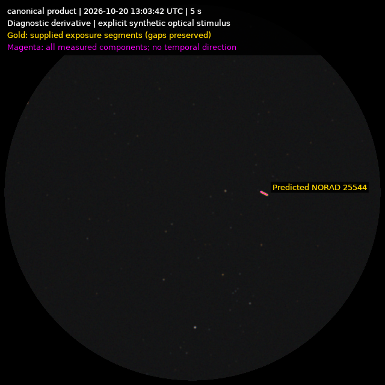
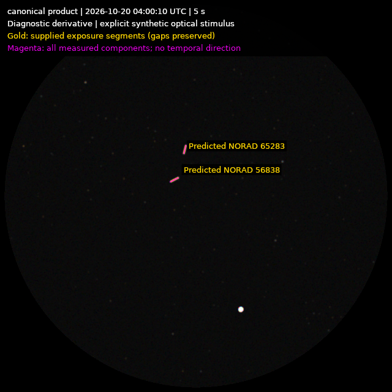
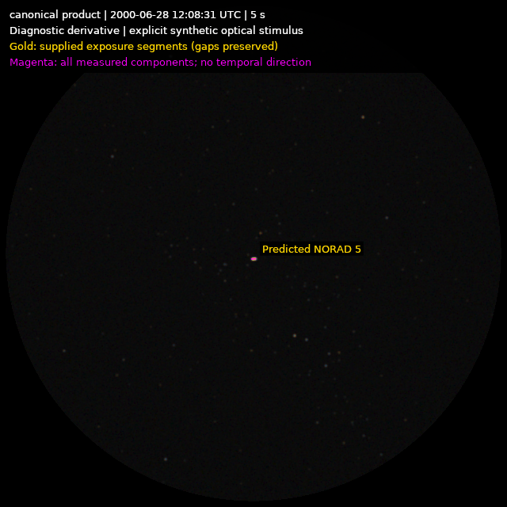

# Canonical orbital products through the virtual camera (#529)

The portable inputs are in
[`tests/fixtures/orbital-prediction-v1/virtual-camera`](../../../tests/fixtures/orbital-prediction-v1/virtual-camera).
They contain small canonical snapshots, twenty canonical exposure products,
ordinary camera settings, explicit optical profiles and source context. The
fixture manifest hashes every input. Modern EOP/leap inputs remain in the
adjacent `time` directory; the small historical final-EOP subset is included.
No live source or production acquisition adapter is required to reproduce them.

All four cases use five contiguous five-second logical exposures at 640x640.
Each runs control, injection and repeat through the existing
`VirtualSkyCameraModule`, generic sky transient renderer, optics, Bayer sensor,
shot/read noise and readout. No raw pixels are painted onto a finished image.
The normal Processing input and `CausalProvisional` temporal factories then
feed unchanged Imaging extraction. Frames one and two return their actual
`Missing` cold-start results; frame three uses N-2/N-1 and no future frame.

| Case | Observer | First exposure UTC | Control / injected candidates |
| --- | --- | --- | ---: |
| ISS 25544 | Seattle, 47.6062/-122.3321/50 m | 2026-10-20 13:03:32.287674 | 0 / 1 |
| Starlinks 56838 and 65283 | HVO, 35.347/-113.878/0 m | 2026-10-20 04:00:00 | 0 / 2 |
| Historical Vanguard 1 / NORAD 5 | Sydney, -33.8688/151.2093/50 m | 2000-06-28 12:08:21 | 0 / 1 |
| Explicit synthetic ISS fade | Same Seattle geometry/time | Same ISS interval | 0 / 1 |

Heights are assumed WGS84 ellipsoidal values. Each of the four repeated
five-frame raw sequences is byte-identical to its injected sequence. This is
accelerated virtual exposure evidence, not a real five-second arrival schedule.
The camera settings retain their original 20-second night-exposure and 60-second
capture-interval fields for rig identity; explicit capture requests supply the
five-second logical shutter interval. These fields must not be silently edited.

## Geometry, provenance and private truth

The inputs are exact `OrbitalPredictionJson.SerializeTrack` bytes; strict shared
parsing rejects noncanonical/tampered products. The harness binds observer,
existing rig/profile hash, readout, projection and remaining image transform,
and independently recomputes each supplied drawable pixel within 1e-8 px.
The products identify the qualified WGS72/mode-a propagation implementation,
actual retained EOP/leap hashes and conventions, selected record, snapshot,
source policy, estimated timing and unknown clock/physical uncertainty.
Native sensor/readout transforms are applied exactly once.

The two-Starlink snapshot is an explicitly partial subset of the retained
16,754-object response. Its original records and source/parser/normalizer
identities are unchanged. The source response is not redownloaded. The small
snapshots' preparation is documented by the retained research mapper sources
[`research-fixture-mapper.cs.txt`](research-fixture-mapper.cs.txt) and
[`historical-fixture-mapper.cs.txt`](historical-fixture-mapper.cs.txt).
These are research input-preparation records, not #528 production parsers.
Its separate full-population resource input and measurements are described in
[`component-resources.md`](component-resources.md).

NORAD 5 uses the already retained Vallado verification elements near their
2000 epoch. NASA records loss of contact in 1964 in
[its Vanguard history](https://www.nasa.gov/history/60-years-ago-vanguard-fails-to-reach-orbit/).
That historical context is retained separately: element source-asserted type
and status remain null. The fixture is not a current prediction from old
elements or adoption of a new inactive-object feed. Its original HTTP retrieval
timestamp was unavailable; the source manifest explicitly records the actual
offline fixture read and distinguishes the unknown original retrieval.

Constant magnitude -3, angular width 0.05 degrees, white RGB weights and seed
527 are explicit synthetic stimulus. The fourth case instead fades by twelve
magnitudes between scenario seconds 10 and 12.5, remaining faint through 25.
It exercises a synthetic light transition; no physical Earth-shadow model was
approved, and every orbital illumination fact stays `Unknown`.

Simulator configuration, labels, source identity, magnitude and predicted paths
stay in private truth and diagnostic derivatives. The ordinary detector sees
raw artifacts, layout, timing and ordinary compatibility only. Gold paths and
bounded `Predicted NORAD ...` labels are added after extraction; magenta shows
all measured components without a temporal direction or identity assignment.
The post-extraction truth comparison retains every candidate/path pairing.

The private best-path perpendicular RMS values are 0.02788 raw pixels for ISS,
0.00550/0.01466 for the two Starlink components, and 0.05387 for Vanguard.
Unordered endpoint discrepancies are approximately 1.246, 0.459/1.535 and
1.353 pixels respectively. These few illustrative comparisons are not a
sensitivity, false-positive, association or population accuracy qualification.
In particular, the short historical trace is only about six raw pixels long.

Control and injected configurations share seed/noise settings. They do not
promise identical noise outside the injected support: the existing sequential
Poisson sampler consumes a signal-dependent number of random values below
thirty expected electrons. Some cases therefore change many background pixel
codes. Changed-pixel counts are not satellite masks. Repeat identity is the
reproducibility check; detector/truth comparisons remain separate.

## Reproduce the camera images

Use the pinned stable SDK and an already verified HYG 4.2 catalog package.
Choose a new output root. The explicit font notice is copied alongside the
font; neither a private catalog database nor a font binary is committed here.

```bash
dotnet build tools/HVO.SkyMonitor.VirtualSkyPoc/HVO.SkyMonitor.VirtualSkyPoc.csproj --configuration Release -warnaserror
poc_dll=tools/HVO.SkyMonitor.VirtualSkyPoc/bin/Release/net10.0/HVO.SkyMonitor.VirtualSkyPoc.dll
fixture_root=tests/fixtures/orbital-prediction-v1/virtual-camera
output_root=/tmp/orbital-camera-reproduction-v1
verified_catalog_root=/path/to/hyg-v42-production
mkdir -p "$output_root/font"
cp /usr/share/fonts/truetype/dejavu/DejaVuSans.ttf "$output_root/font/diagnostic.ttf"
cp /usr/share/doc/fonts-dejavu-core/copyright "$output_root/font/diagnostic.ttf.license"

iss_tracks=(); starlink_tracks=(); inactive_tracks=()
for index in 01 02 03 04 05; do
  iss_tracks+=("$fixture_root/tracks/iss/track-$index.json")
  starlink_tracks+=("$fixture_root/tracks/starlink-56838/track-$index.json")
  inactive_tracks+=("$fixture_root/tracks/inactive/track-$index.json")
done
for index in 01 02 03 04 05; do
  starlink_tracks+=("$fixture_root/tracks/starlink-65283/track-$index.json")
done

dotnet "$poc_dll" satellite-tracks "$output_root/iss" "$verified_catalog_root" "$fixture_root/settings-seattle.json" "$fixture_root/optical-5s.json" "$output_root/font/diagnostic.ttf" "${iss_tracks[@]}"
dotnet "$poc_dll" satellite-tracks "$output_root/starlinks" "$verified_catalog_root" "$fixture_root/settings-hvo.json" "$fixture_root/optical-5s.json" "$output_root/font/diagnostic.ttf" "${starlink_tracks[@]}"
dotnet "$poc_dll" satellite-tracks "$output_root/inactive" "$verified_catalog_root" "$fixture_root/settings-sydney.json" "$fixture_root/optical-5s.json" "$output_root/font/diagnostic.ttf" "${inactive_tracks[@]}"
dotnet "$poc_dll" satellite-tracks "$output_root/fade" "$verified_catalog_root" "$fixture_root/settings-seattle.json" "$fixture_root/optical-synthetic-fade.json" "$output_root/font/diagnostic.ttf" "${iss_tracks[@]}"
```

Every run retains raw/control/injected/repeated frames, PNG derivatives,
canonical product copies, ordinary detector outcomes, private simulation truth,
source-at-launch copies, assembly hashes and embedded Git identities, resources,
an independent file-checksum manifest and self-contained comparison HTML.
The assembly hashes/embedded commit are authoritative for the executed code;
source-at-launch copies can include a later tooling-only dispatch extension.
The recorded sample captures executed tool commit `0b2eb1a3`. The subsequently
added resource command does not change capture/detection behavior.

## Regenerate the canonical predictions

This uses the actual shared engine from the portable snapshot, not a second
propagator in the tooling. A new output directory is required. Each call creates
five tracks, repeats the same immutable queries and checks exact canonical
bytes. `result-*.json` and `prediction-evidence.json` retain method-boundary
resources and product identities; elapsed measurements are not product inputs.

```bash
time_root=tests/fixtures/orbital-prediction-v1/time
dotnet "$poc_dll" satellite-predict "$output_root/generated-iss" "$fixture_root/settings-seattle.json" "$fixture_root/snapshots/six-facts/manifest.json" "$fixture_root/snapshots/six-facts/records.json" "$time_root/predicted-2026.finals2000A" "$time_root/leap-seconds.list" 25544 2026-10-20T13:03:32.287674Z 5
dotnet "$poc_dll" satellite-predict "$output_root/generated-starlink-56838" "$fixture_root/settings-hvo.json" "$fixture_root/snapshots/two-starlinks/manifest.json" "$fixture_root/snapshots/two-starlinks/records.json" "$time_root/predicted-2026.finals2000A" "$time_root/leap-seconds.list" 56838 2026-10-20T04:00:00Z 5
dotnet "$poc_dll" satellite-predict "$output_root/generated-starlink-65283" "$fixture_root/settings-hvo.json" "$fixture_root/snapshots/two-starlinks/manifest.json" "$fixture_root/snapshots/two-starlinks/records.json" "$time_root/predicted-2026.finals2000A" "$time_root/leap-seconds.list" 65283 2026-10-20T04:00:00Z 5
dotnet "$poc_dll" satellite-predict "$output_root/generated-inactive" "$fixture_root/settings-sydney.json" "$fixture_root/snapshots/inactive/manifest.json" "$fixture_root/snapshots/inactive/records.json" "$fixture_root/final-2000.finals2000A" "$time_root/leap-seconds.list" 5 2000-06-28T12:08:21Z 5
```

## Samples and limits






[`samples/evidence.json`](samples/evidence.json) binds products and external
full-run file-manifest identities. The sample star fields derive from HYG 4.2,
compiled by David Nash/Astronexus, transformed into the verified HVO catalog
and rendered with synthetic sensor/satellite effects and diagnostic labels.
PNG samples are distributed under CC BY-SA 4.0 with retained
[attribution](samples/ATTRIBUTION-HYG.md) and [license](samples/LICENSE-HYG.md).
The database SHA256 is
`B51D18B722199E89AA8FE4622EBE507346C75EFFB375E546881452A263F0B9E2`.

No physical orbit covariance, optical brightness, attitude/flare prediction,
formal all-input interval certificate, raster-integration error bound, full
resolution throughput, actual shutter accuracy, measured satellite identity
or complete live cadence is established. #528 remains the live snapshot
integration requirement, #1393 application layer/pass composition, #530 measured
association and #1395 declared-hardware/resolution complete arrival-to-publication
qualification. Current numerical sampler and renderer tolerances are different
facts; the existing renderer still uses 64 temporal midpoint integration samples.
